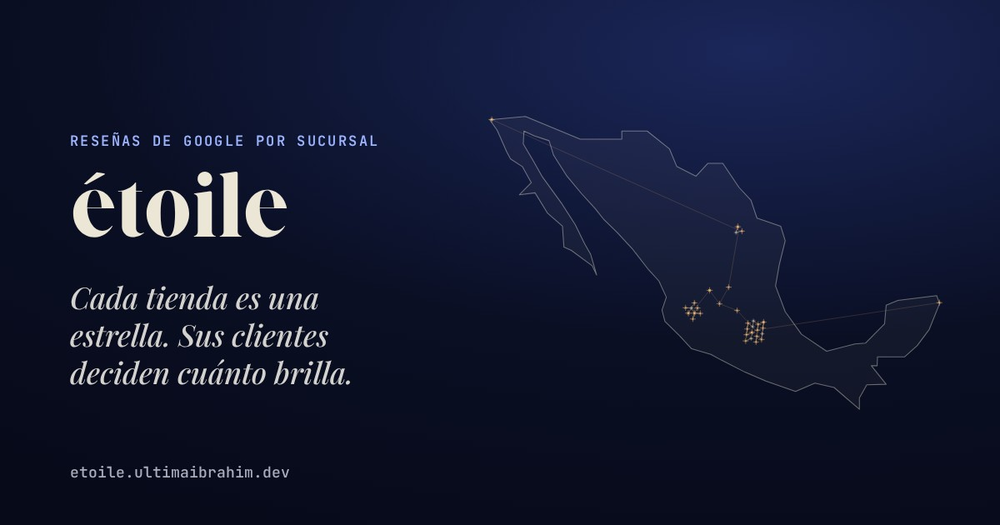
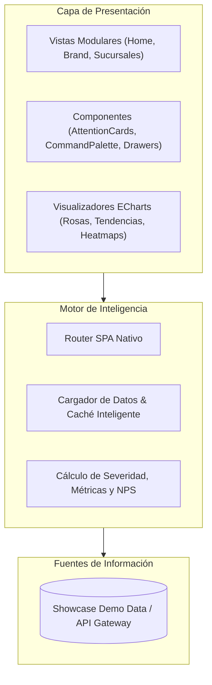

<div align="center">
  
</div>

# 🌟 étoile
### Hospitality Operations & Sentiment Intelligence Platform

[](#)
[](#)
[](#)
[](LICENSE)

*Plataforma de inteligencia operacional para marcas de alta cocina y hospitalidad. Convierte reseñas de múltiples ubicaciones y métricas dispersas en cuadrantes de desempeño, detección temprana de quejas críticas y pines de reconocimiento operativo.*

---

## 🎨 Filosofía de Diseño: Crystal & Squircle
étoile fue concebido bajo el lenguaje editorial de alta gama:
- **Tipografía**: Maridaje entre serifa display editorial (*Giaza*) y grotesca geométrica contemporánea (*Plus Jakarta Sans*).
- **Geometría Squircle**: Curvas continuas (`border-radius: 12px - 18px`), elevación volumétrica y tarjetas de atención flotantes.
- **Micro-interacciones Fluidas**: Paleta de comandos (`Ctrl + K` / `Cmd + K`), cajones inferiores ergonómicos y animaciones a 60 FPS sin saltos de layout.

---

## ⚡ Capacidades Principales

- **Analítica de Sentimiento Multicanal**: Clasificación de incidentes, áreas de fricción y menciones destacadas de servicio.
- **Matriz de Cuadrantes & Benchmarking**: Comparativa de sucursales frente a la meta global de la marca con visualizaciones Apache ECharts personalizadas.
- **Sistema de Pines & Reconocimiento**: Premiación simbólica a sucursales y personal con desempeño extraordinario sostenido.
- **Offline-First & Demo Mode**: Totalmente desacoplado de bases de datos externas para demostraciones ejecutivas fluidas.

---

## 🏗️ Arquitectura del Sistema



---

## 🚀 Vista Previa Local

Para ejecutar la vitrina en tu entorno local sin instalar dependencias pesadas:

```bash
# Clonar repositorio
git clone https://github.com/ultimaibrahim/etoile.git
cd etoile

# Servir con Python
python3 -m http.server 8080
```
Abre tu navegador en `http://localhost:8080`.

---

<div align="center">
  <sub>Diseñado y construido con obsesión por el detalle por <a href="https://ultimaibrahim.dev">Ibrahim García</a></sub>
</div>
